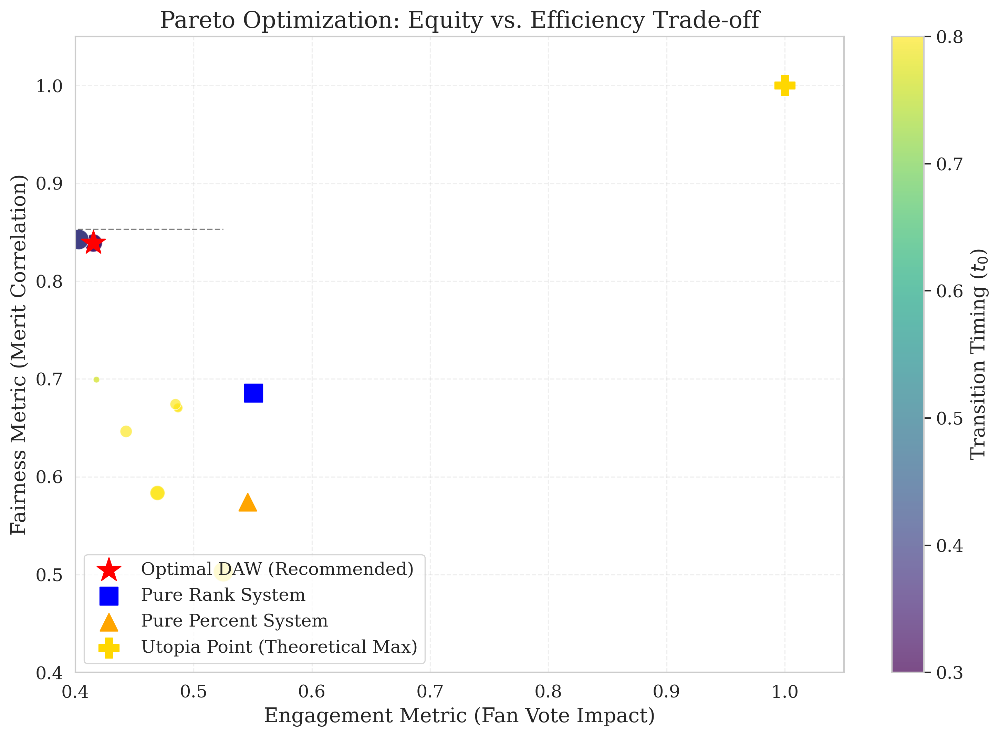

# MCM 2026 Problem C — Modeling Fan Votes and Evaluating Voting Rules

**2026 COMAP Mathematical Contest in Modeling (MCM), Problem C · Meritorious Winner (M) · Solo entry**

> **The Invisible Hand of the Audience: A Bayesian Inverse Optimization Framework for Mechanism Audit and Design**

This repository contains the modeling and computational work developed for MCM 2026 Problem C, which studies how judges' scores and audience votes jointly affect outcomes in *Dancing with the Stars*. The project estimates unobserved audience support from publicly observed competition outcomes, compares alternative aggregation rules, and explores an adaptive weighting proposal.

The code and archived outputs are shared as a record of a contest project, **not** as a fully verified, plug-and-play research package.

## Research questions

1. **Latent votes:** What audience-vote patterns are compatible with the observed scores, eliminations, and competition rules?
2. **Rule comparison:** How might rank-based versus percentage-based aggregation change simulated outcomes?
3. **Mechanism design:** Can an adaptive weighting rule balance technical scores, audience preferences, and other stated objectives?

The audience vote distribution is not directly observed. Estimates and counterfactual outcomes therefore depend on the specified priors, constraints, and simulation assumptions; they are **not** recovered ground truth or causal effects established from randomized data.

## Approach

The implementation is organized into six stages:

| Stage | Purpose | Main code |
| --- | --- | --- |
| 1. Data preparation | Parse and clean season-level records; construct model features | `src/etl/` |
| 2. Latent-vote inference | Bayesian-style constrained sampling with a C++/Python bridge | `src/bridge/`, `src/core/`, `cpp_kernel/` |
| 3. Rule comparison | Simulate alternative voting rules and examine outcome sensitivity | `src/simulators/`, `src/analysis/` |
| 4. Attribution analysis | Explore relationships between scores, partners, and modeled outcomes | `src/analysis/` |
| 5. Weighting-rule design | Evaluate candidate adaptive rules and trade-offs | `src/solvers/` |
| 6. Report generation | Export selected summaries, tables, and figures | `src/utils/`, `reports/` |

**Technical components:** Python (NumPy, pandas, SciPy, Numba), C++17 (Eigen, OpenMP, pybind11), simulation, statistical modeling, and multi-objective optimization. See `requirements.txt` and `cpp_kernel/CMakeLists.txt` for dependencies.

## Selected artifacts

The repository includes code, configuration, data snapshots, and outputs from previous runs. Some entry points and historical files reflect the original contest environment.

- [Mechanism audit summary (JSON)](reports/mechanism_audit/mechanism_audit_summary.json)
- [Mechanism audit figures](reports/mechanism_audit/)
- [Pareto-frontier analysis](reports/final_design/pareto_frontier_analysis.png)
- [Competition modeling configuration](conf/rules.yaml)
- [Main stage-oriented pipeline](main_pipeline.py)



These are **archived project outputs**, not independently rerun benchmarks. Their interpretation depends on the original parameter settings and experiment definitions; see the code and configuration before citing a number.

## Repository layout

```text
MCM_2026/
├── conf/                 # Rules, priors, and input mappings
├── cpp_kernel/           # C++ sampling extension and CMake build
├── data/                 # Competition input and intermediate snapshots
├── src/
│   ├── etl/              # Data preparation
│   ├── bridge/           # Python–C++ interface
│   ├── core/             # Modeling components
│   ├── simulators/       # Counterfactual simulations
│   ├── analysis/         # Mechanism and sensitivity analysis
│   ├── solvers/          # Design / optimization
│   └── utils/            # Logging and exports
├── reports/              # Archived figures and summaries
├── check_dependencies.py
├── main.py               # Original end-to-end entry point
├── main_pipeline.py      # Stage-oriented entry point
└── requirements.txt
```

## Reproduction notes

The repository was developed in a specific contest-time environment. **A clean-environment end-to-end reproduction has not yet been verified.** In particular, the sampling extension is compiled for a particular Python/platform ABI, and some paths or intermediate files may require preparation.

Recommended starting point on Linux with Python 3.10+ and a C++17 toolchain:

```bash
python -m venv .venv
source .venv/bin/activate
pip install -r requirements.txt

# Requires CMake, Eigen3, and an OpenMP-capable compiler.
cmake -S cpp_kernel -B cpp_kernel/build \
  -Dpybind11_DIR="$(python -m pybind11 --cmakedir)"
cmake --build cpp_kernel/build --config Release -j

# Inspect environment and paths before running expensive stages.
python check_dependencies.py
python main_pipeline.py --help
```

For an incremental attempt, review `conf/rules.yaml`, create any missing configured output directories (notably `data/platinum/`), and start with `python main_pipeline.py --stage 1`. Later stages may require substantial CPU time and intermediate datasets produced by earlier stages. The pipeline presently contains hardware-specific 23-thread defaults; adjust them to the machine before a full run.

The checked-in `bin/` extension is a platform-specific build artifact, **not** a portable dependency. Rebuild it where possible.

## Scope and limitations

- Audience preferences are **latent**; the inference depends on modeling assumptions and constraints.
- Retrospective simulations compare **modeled scenarios**, not experimentally identified causal effects.
- Metrics from a past run should not be generalized without checking the data split, metric definition, priors, and sensitivity analysis.
- Some committed intermediate data, figures, and binaries remain from the competition workflow; the repository has not yet undergone a full cleanup or cross-platform reproducibility audit.

## Provenance and paper access

This was a **solo MCM entry** (2026, Problem C; Meritorious Winner, control number **2622651**). AI-assisted tools were used during parts of coding and English-language manuscript preparation; their use does not substitute for independent verification of the modeling claims.

The competition paper is not included here. A copy can be provided privately on request, subject to the competition organizer's publication and sharing rules. Please check the applicable terms before redistributing competition materials or republishing the full paper.

## Status

**Archived contest project; README refreshed for technical review.** Further work would prioritize reproducibility checks, clearer experiment provenance, and separating essential source files from environment-specific artifacts.
